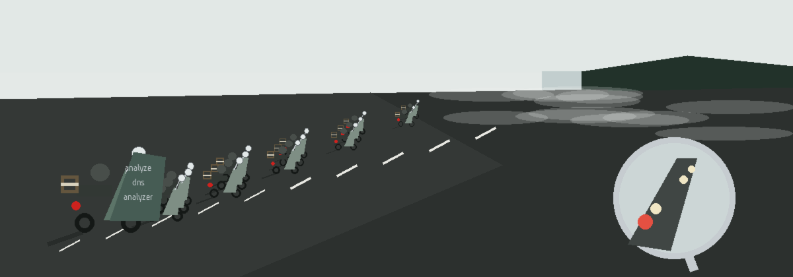

# analyze-dns-analyzer

# analyze-dns-analyzer
Analyzes DNS traffic for suspicious patterns like domain generation algorithms (DGAs) and fast-flux DNS. - Focused on Data analysis and reporting

## Install
`git clone https://github.com/ShadowStrikeHQ/analyze-dns-analyzer`

## Usage
`./analyze-dns-analyzer [params]`

## Parameters
- `-h`: Show help message and exit
- `--domain_threshold`: No description provided
- `--ip_change_threshold`: No description provided
- `--output_file`: No description provided
- `--debug`: Enable debug logging.

## License
Copyright (c) ShadowStrikeHQ

> Glovebox note: three parameters arrive with no description in the source: --domain_threshold, --ip_change_threshold, and --output_file. They are listed by name above and given no invented defaults, units, or effects. The licence line at the close is a copyright line only: Copyright (c) ShadowStrikeHQ, with no licence named.
